# Architecture

This repository is the complete configuration and tooling of one home's
automation platform: an event-driven system on [Home Assistant](https://www.home-assistant.io/)
that turns radar, radio and cloud signals into light, curtain, climate and
notification decisions. It has been in daily use since March 2026.

Two loops shape it, and this document describes both:

1. **The runtime loop.** Sensor events flow through validation into a set of
   explicit state machines, and only the state machines act.
2. **The engineering loop.** An AI coding agent writes the changes under codified
   guardrails, and a change reaches the house only after hooks, tests and Home
   Assistant's own validator have accepted it.

Most of the operational documentation is in Danish, the household's working
language. This file, [README.md](README.md), [SECURITY.md](SECURITY.md),
[docs/methodology.md](docs/methodology.md) and the [decision records](docs/adr/)
are the English entry points.

---

## System at a glance

| | |
|---|---|
| Host | Intel NUC, Home Assistant OS, Home Assistant Core 2026.9 |
| Radios | Zigbee (ZHA, 48 devices), Thread/Matter (17 devices), Wi-Fi/ESPHome (mmWave radars), Hue bridge, 433 MHz RF (Broadlink) |
| Cloud inputs | DMI and met.no weather, Energi Data Service and Nord Pool electricity prices, Roborock, Nemlig.com groceries, Google Sheets, phone GPS |
| Features | listed in the README under [What the house does](README.md#what-the-house-does) |
| Configuration | 300+ YAML files: 680+ automations, 700+ tunable sliders, 9 room-mode state machines |
| Tooling | 65 Python files: validators, generators, an offline Home Assistant harness, CLI tools for live history |
| History | about 2,300 commits; this repository is a sanitized snapshot of the current tree |

---

## 1. The runtime loop

```mermaid
flowchart LR
    subgraph S["Sensors & APIs"]
        direction TB
        S1["mmWave radars<br/>presence per zone"]
        S2["Zigbee<br/>remotes · motion · contact · plugs"]
        S3["Matter over Thread<br/>lights · climate sensors"]
        S4["Cloud APIs<br/>weather · power price · vacuum"]
        S5["Phones<br/>GPS · alarms · button replies"]
    end
    subgraph I["Ingestion & Validation"]
        direction TB
        I1["Health gates<br/>is the channel alive?"]
        I2["Freshness & fallback<br/>resilient sensors"]
        I3["Sustained anchors<br/>presence that held"]
        I4["Restart-safe stamps<br/>written timestamps"]
    end
    subgraph M["State Machine"]
        direction TB
        M1["room_mode per room<br/>Auto · Manual · Off"]
        M2["house_state<br/>Active · Dormant"]
        M3["house_mode<br/>Normal · Guest · Home Vacation"]
        M4["activity_state<br/>computed"]
        M5["Lamp ownership<br/>ranked writers"]
    end
    subgraph W["Action & Write-back"]
        direction TB
        W1["Lights<br/>fades · scenes"]
        W2["Curtains<br/>sun defense"]
        W3["Notifications<br/>deduplicated queue"]
        W4["Radar config<br/>guarded writes"]
        W5["Trainers<br/>JSONL ground truth"]
    end
    S --> I --> M --> W
    W -. trainers calibrate thresholds .-> I
    W -. a person's adjustment sets Manual .-> M
```

### 1.1 Sensors and APIs

Presence comes from mmWave radars (Apollo MSR-2 on ESPHome, one per main room,
some split into several zones) and Zigbee motion sensors in the small rooms.
Radar sees a person who sits still, which a PIR sensor does not, but it also
sees ghosts: reflections, a fan, a robot vacuum. Much of the ingestion layer
exists because of that trade.

The other inputs are wall remotes and buttons (IKEA STYRBAR and SOMRIG over
Zigbee), contact sensors, climate sensors on Thread, light sensors (an LTR390
in each radar), smart plugs, phone GPS and alarms, and a handful of cloud APIs.

### 1.2 Ingestion and validation

No automation acts on a raw sensor state. Each reads a validated signal:

- **Health gates.** `binary_sensor.presence_sensors_available` is on when at
  least one presence channel reports. When every channel is down, the
  presence-driven automations skip instead of reading `unavailable` as
  "nobody is home". A dead channel is a fact the system knows about, not a
  value it acts on.
- **Freshness and fallback.** Indoor humidity and temperature come from
  `sensor.indoor_humidity_resilient` and `sensor.indoor_temperature_resilient`,
  which fall back to a second instrument when the Thread sensor drops off the
  network (the `kilde` attribute names the source). A bathroom light is never
  switched off automatically without a *fresh* humidity reading
  (`binary_sensor.badevaerelse_fugt_frisk`): someone may be in the shower.
- **Sustained anchors.** A radar-derived binary flickers, and one 1-second blip
  resets every "off for N minutes" condition. Silence is therefore measured on
  `sensor.last_sustained_presence`, an anchor only moved by presence that held.
- **Restart-safe stamps.** `last_changed` resets on every restart, so it cannot
  measure how long something has been true. Durations that matter are written
  to `input_datetime` helpers (for example `input_datetime.<room>_apollo_occ_since`).
- **Reload-safe triggers.** A template reload sends every template entity
  through `unavailable`. A trigger on `to: "off"` would then fire on the
  reload, so triggers on template entities name an explicit `from:` state
  (`scripts/b103_scan.py` blocks the commit otherwise).

### 1.3 State machines

The house is described by a few explicit state machines with one owner each,
rather than by flags scattered across automations.

| Machine | States | Set by |
|---|---|---|
| `input_select.room_mode_<room>` (9 rooms) | Auto, Manual, Off | a remote press or a person's app adjustment sets Manual; *drift-back* returns the room to Auto after it has been empty, with a 10-minute fade |
| `input_select.house_state` | Active, Dormant | departure, long absence and schedules make the house Dormant; doors, presence and arrivals make it Active |
| `input_select.house_mode` | Normal, AirBnB, Home Vacation | the owners; `AirBnB` is the guest mode for short-term rental stays |
| `sensor.activity_state` | away, godnat, cooking, dining, sofa_relax, bedroom_only, nightwalk, bath_visit … | computed from which zones are active and the time of day |
| `input_boolean.godnat_active` | night mode | bedroom buttons or an automatic declaration; ends with presence in a shared room after 06:00 |

**Manual always wins, and the system can tell who acted.** A light change
counts as a person's when its context carries a `user_id`; never because it
lacks a parent context (scenes and scripts also lack one). Button presses carry
no `user_id`, so their handlers stamp the press themselves.

**Contested lamps have a written order of precedence.** When several
automations may write the same lamp (the kitchen light chain has sixteen
claimants, from the smoke alarm down to the night-walk light), a registry in
[`ejerskab/`](ejerskab/) ranks them, and
`scripts/ejerskab.py` generates a `sensor.<lamp>_ejer` that names the current
owner. A writer that is not in the registry fails the commit.

**The guest mode is a first-class state, not an afterthought.** Every feature
must define how it behaves in `AirBnB` mode, and a guest must be able to get
out of any state the system put them in without knowing how it works. The
mode has its own night regime and suppresses notifications to the owners'
phones.

### 1.4 Action and write-back

- **Lights** fade; nothing snaps. Brightness, colour temperature, fade time and
  switch-off delay are each a room base value multiplied by a global factor
  that the owners tune with one slider (`sensor.global_brightness_factor`,
  `sensor.global_absence_wait_factor`, `sensor.global_fade_factor` …).
  Matter calls carry `continue_on_error: true`, because a Matter timeout
  otherwise aborts the whole script.
- **Curtains** follow a summer and a winter defense against sun and cold. The
  433 MHz motors report no position, so a position is an assumption, and no
  gate trusts it after a restart.
- **Notifications** that can only be acted on at home are queued per recipient
  until that person arrives (`scripts/notif_queue.py`). Repeats collapse to the
  newest, so a week of daily plant reminders becomes one push on arrival, and
  the queue holds outside its delivery window and in guest mode.
- **Radar configuration** is written only on a person's intent and only when
  the value differs: two radar chips failed after thousands of redundant
  flash writes.
- **Trainers** close the loop. When a classifier is uncertain (an activity
  guess, an arrival, whether a lamp or daylight explains a lux reading, a
  people-count estimate), the system asks with an actionable phone
  notification. Answers are appended to JSONL files with the full signal
  context, and later changes are calibrated against them. A trainer stays
  silent when its recent answers agree with the guess (`scripts/trainer_tvivl.py`).

### 1.5 Tunables live in helpers, values live in git

More than 700 `input_number` sliders hold the thresholds, delays and factors, so a
behaviour change rarely needs a deploy. Their values live in Home Assistant's
storage, not in YAML, so `scripts/helpers_export.py` snapshots them to
[`config_snapshots/`](config_snapshots/), and a fresh install is seeded from
that snapshot. The pre-commit hook rejects a snapshot pair that does not match.

---

## 2. The engineering loop

The platform is developed with Claude Code running on the production host, with
SSH and REST access. The person does the physical work: pairing devices,
OAuth, flipping a switch to test. The agent does the rest: diagnosis from
history, code, commit, deploy, restart and verification. Full access is only
safe with guardrails, and the guardrails are code.

```mermaid
flowchart LR
    subgraph R["Context & Routing"]
        direction TB
        R1["CLAUDE.md<br/>recognition layer"]
        R2[".claude/rules<br/>16 path-scoped files"]
        R3["agent_guard.py<br/>≤ 2 subagents · cheap triage models"]
    end
    subgraph G["Guardrailed Codegen"]
        direction TB
        G1["Measure first<br/>hq.py hist --stats"]
        G2["28 failure classes<br/>signature → method"]
        G3["Ownership hook<br/>ejerskab_hook.py"]
        G4["Offline proofs<br/>ha_offline.py check · equiv · staging"]
    end
    subgraph T["Pre-Commit & Tests"]
        direction TB
        T1["pre-commit<br/>secrets · reload scan · ownership<br/>rosters · snapshots · ruff · yamllint"]
        T2["pre-push<br/>Home Assistant's own config check"]
        T3["CI<br/>lint · test · validate · security"]
    end
    subgraph D["Production Deployment"]
        direction TB
        D1["fetch → fast-forward pull"]
        D2["ha_restart.sh<br/>save state, then restart"]
        D3["ha_health.sh deploy<br/>silent automations?"]
        D4["Verify on real devices<br/>push summary"]
    end
    R --> G --> T --> D
    D -. a recurring defect becomes a rule, then a check .-> R
```

### 2.1 Routing: what the agent knows, and who does the work

- **[CLAUDE.md](CLAUDE.md)** loads into every session, so every line in it is
  paid for in every session. It is a recognition layer: each rule is a
  one-line signature and a pointer to the long version in `docs/`, which costs
  nothing until it is read.
- **[`.claude/rules/`](.claude/rules/)** holds 16 domain files (radar presence,
  Thread/Matter, bulbs, curtains, energy …). Each declares `paths:` globs and
  loads the first time a matching file is read. A PreToolUse hook
  (`scripts/claude_rules.py hook`) also loads it when the agent reaches the
  domain through a shell command instead.
- **Subagents are the exception.** Each starts cold and re-reads the
  context, so lookups and edits happen in the main session; subagents are for
  broad sweeps and return conclusions only. `scripts/agent_guard.py` enforces
  the limits a quota can survive: at most two at a time, cheaper models for
  read-only triage, no unbounded fan-out.

### 2.2 Guardrailed code generation

- **Measure before setting a number.** A threshold is set from the
  distribution of the channel the gate actually reads, over two to three days
  (`scripts/hq.py hist <entity> --stats`). Notes and code comments are
  hypotheses with a timestamp, not measurements.
- **Failure classes.** 28 recurring defect patterns, each with a recognisable
  signature and a method, are checked before a change is called done. They
  were mined from the project's own history; see
  [docs/methodology.md](docs/methodology.md).
- **Ownership hook.** Opening a file that writes a registered lamp makes the
  agent see that lamp's ownership table before it edits.
- **Restart guard.** Home Assistant segfaults on shutdown in this setup, so
  the final state save never happens. `scripts/restart_guard.py` rejects a
  plain `ha core restart`; `scripts/ha_restart.sh` saves state first.
- **Offline proofs.** `scripts/ha_offline.py` runs Home Assistant's own loader
  and validator against the repository with no hardware and no secrets:
  `check` (is it valid?), `equiv` (is the resolved config unchanged? — a
  structural refactor must produce an empty diff), `staging` (does the house
  boot headless as a fresh install?), `refs` (does everything referenced exist?).

### 2.3 Pre-commit, tests and CI

The same checks run in three places: git hooks on the production host,
Makefile targets for a developer, and CI. `scripts/tests/test_tooling_parity.py`
fails when the three drift apart.

| Check | What it prevents |
|---|---|
| `secrets_contract.py` + gitleaks | a credential in a tracked file; a secret read outside `ha_secrets.py` |
| `b103_scan.py` | triggers that fire on a template reload |
| `ha_validate.py` (dups, matter, placeholders) | duplicate automation ids, Matter calls without `continue_on_error` |
| `ejerskab.py check` / `lint` | a lamp writer outside its ownership registry |
| `rosters.py jinja --check` | entity lists that drift between copies ([`rosters/`](rosters/)) |
| `helpers_export.py --check-derived` | a fresh-install seed that does not match the snapshot |
| `claude_rules.py check` | a rule file whose globs match nothing; more than three sprint notes in CLAUDE.md (its size only warns) |
| ruff, yamllint, mypy, pytest | style and type errors, unit-test regressions |
| `ha_offline.py check` (pre-push, CI) | an automation Home Assistant would disable as invalid |

### 2.4 Deployment

On the production host: commit, fetch, fast-forward pull (a diverged branch
stops for review), `bash scripts/ha_restart.sh`, then
`./scripts/ha_health.sh deploy`. The last step matters because Home Assistant
disables an automation with an invalid template silently, with no error at
commit, deploy or reload. A change with a physical effect is then verified on
real devices with timestamps from history, never with synthetic events. A
short push notification summarises what went live.

---

## 3. Repository map

| Path | Contents |
|---|---|
| [`configuration.yaml`](configuration.yaml) | entry point; loads `packages/`, `automations/`, `script_pkg/` |
| [`packages/`](packages/) | one package per feature: helpers, template sensors, automations together |
| [`automations/`](automations/) | automations grouped by domain (presence, buttons, curtains, modes …) |
| [`script_pkg/`](script_pkg/) | scripts: scenes, room logic, shared actions |
| [`rosters/`](rosters/), [`ejerskab/`](ejerskab/) | shared entity lists; lamp ownership registries |
| [`dashboards/`](dashboards/) | hand-curated Lovelace dashboards |
| [`custom_components/`](custom_components/), [`custom_zha_quirks/`](custom_zha_quirks/), [`addons/`](addons/) | a patched integration, a Zigbee quirk, two local add-ons |
| [`scripts/`](scripts/) | validators, generators, CLI tools, git and agent hooks, tests |
| [`config_snapshots/`](config_snapshots/) | helper values and the fresh-install seed derived from them |
| [`docs/`](docs/) | design notes, failure classes, runbooks; [`docs/auto/`](docs/auto/) is generated |
| [`CLAUDE.md`](CLAUDE.md), [`AGENTS.md`](AGENTS.md), [`.claude/`](.claude/) | the agent's instruction set, navigation map, rules and hooks |
