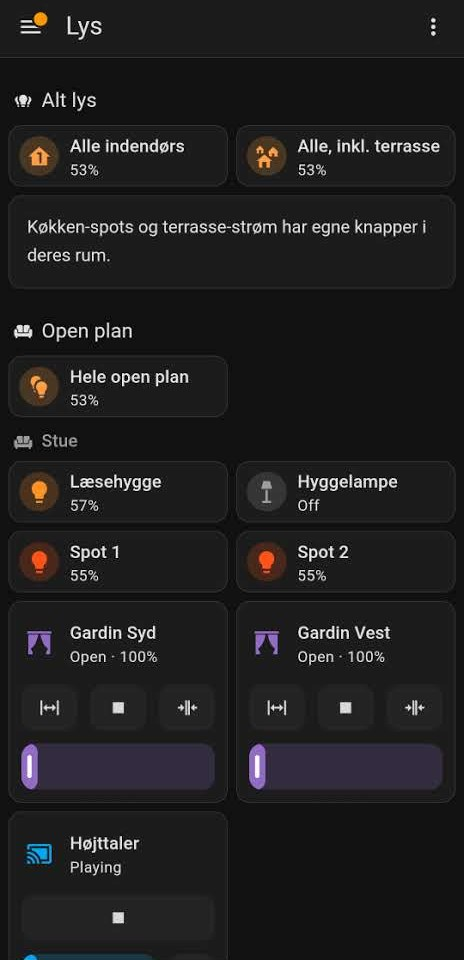
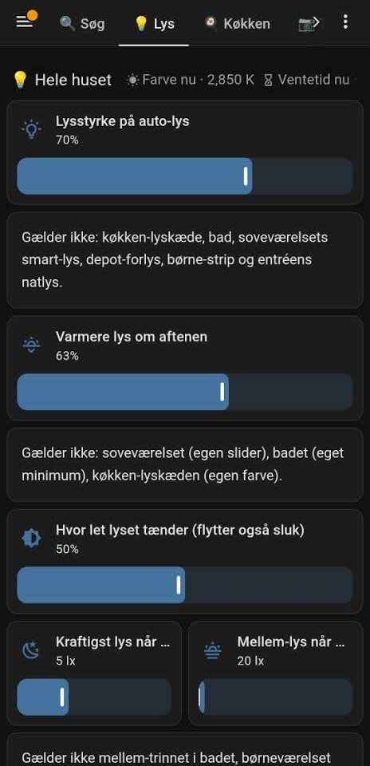
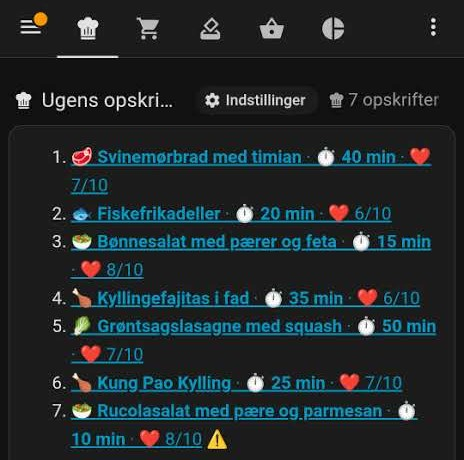
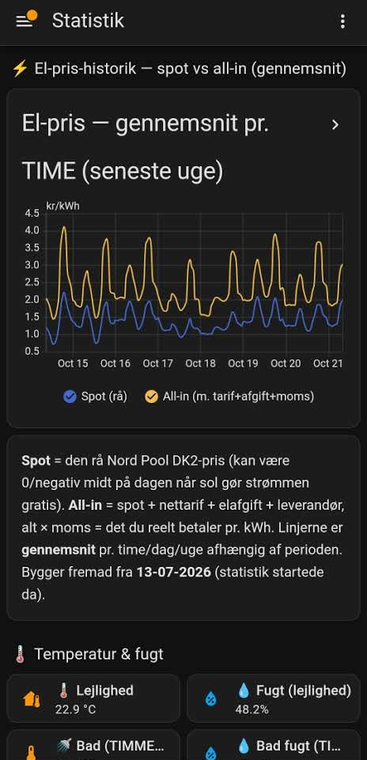
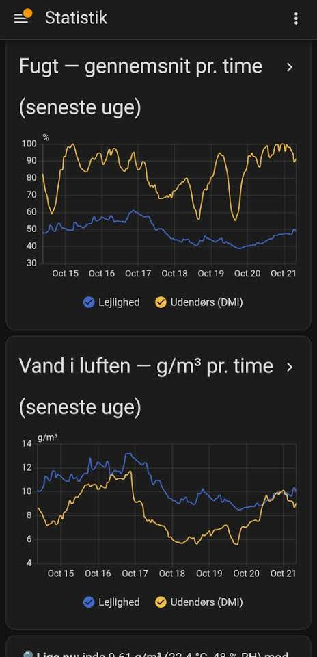
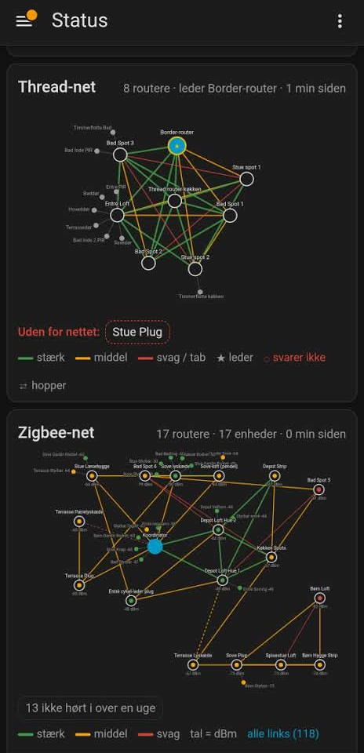
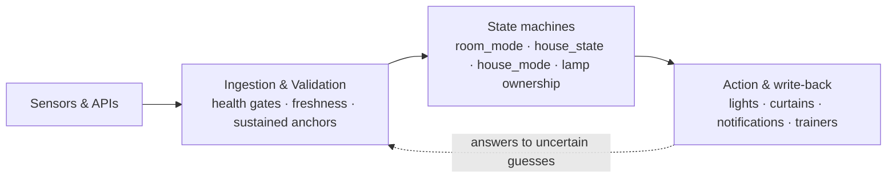

# Home Automation Platform

An event-driven IoT and data automation platform for one home, built on
[Home Assistant](https://www.home-assistant.io/) and developed with an
AI-native engineering method: a coding agent writes and deploys the changes,
and codified guardrails, tests and Home Assistant's own validator decide what
reaches the house.

It turns mmWave radar presence, Zigbee and Thread devices, phone location and
cloud data (weather, electricity prices) into decisions about light, curtains,
climate and notifications. It has been in daily use since March 2026.

| | |
|---|---|
| Configuration | 300+ YAML files: 680+ automations, 700+ tunable sliders, 9 room-mode state machines |
| Devices | 48 Zigbee, 17 Matter over Thread, 5 mmWave radars on ESPHome, a Hue bridge, 433 MHz RF curtains |
| Tooling | 65 Python files: an offline Home Assistant harness, validators, generators, history CLI, agent hooks |
| Guardrails | 16 path-scoped agent rules, 5 agent skills, 28 documented failure classes, pre-commit and pre-push hooks, CI |
| History | about 2,300 commits in seven months, published as one sanitized snapshot |

## A day in the house

| | |
|---|---|
| **Morning** | A night-time visit that turns into getting up slowly brightens the open plan, and the radio starts at low volume. |
| **Day** | The kitchen light follows measured daylight, and the blinds keep direct sun off a moss wall picture. |
| **Daily** | Both phones vote on dishes, and the approved ones land on one shared shopping list. |
| **Cheap hours** | The e-bikes charge when electricity is cheapest; in expensive hours the lights can dim. |
| **Away** | When the last person leaves through the front door, the house goes dormant, and the robot vacuum cleans if the house has been busy enough. |
| **Evening** | The light gets warmer, a projector mode darkens three rooms, and the house notices when everyone has gone to bed. |
| **Night** | A guest sleeping in the living room keeps the open plan dark and quiet until morning. |

Most rows react to presence, daylight, doors or prices rather than a clock,
and their thresholds are sliders, tuned against the house's recorded history.

## The dashboards

Everyday control happens on a phone. The labels are Danish, the household's
language.

<table>
  <tr>
    <td align="center" width="33%"><br><sub><b>Lights</b>: the whole house, the open plan and each room, with blinds and the speaker</sub></td>
    <td align="center" width="33%"><br><sub><b>Tuning</b>: house-wide sliders, each stating which lamps it does <i>not</i> reach</sub></td>
    <td align="center" width="33%"><br><sub><b>Meals</b>: the week's recipes with cooking time and the household's rating</sub></td>
  </tr>
  <tr>
    <td align="center"><br><sub><b>Electricity</b>: hourly spot price against the all-in price over a week</sub></td>
    <td align="center"><br><sub><b>Climate</b>: indoor against outdoor humidity, relative and absolute</sub></td>
    <td align="center"><br><sub><b>Radio</b>: the live Thread and Zigbee mesh with link quality</sub></td>
  </tr>
</table>

## What the house does

Most features are one package in [`packages/`](packages/), whose header (in
Danish) records the request it answers and the measurements behind its numbers.

- **Light that follows people.** mmWave radars per room drive lighting through
  per-room state machines; the house only goes dormant after the front door has
  opened, and a manual adjustment always wins. The kitchen light chain follows
  measured daylight, and the bathroom runs light phases with shower detection
  from humidity ([`koekken_lyskaede`](packages/koekken_lyskaede.yaml),
  [`badevaerelse_faser`](packages/badevaerelse_faser.yaml),
  [`wasp_in_a_box`](packages/wasp_in_a_box.yaml)).
- **Daily routines.** A morning ramp that brightens the open plan only if a
  night-time visit turns into getting up; morning radio at low volume; bedtime
  detection, children's wake-up and bedtime light, and a sleepover mode that
  keeps the open plan dark ([`morgen_opstigning_rampe`](packages/morgen_opstigning_rampe.yaml),
  [`hoejttaler_radio`](packages/hoejttaler_radio.yaml), [`sleepover`](packages/sleepover.yaml)).
- **Curtains and sun defence.** RF roller blinds driven through a Broadlink
  bridge with estimated positions, glare control, and a sun model that keeps
  direct light off a moss wall picture ([`mosbillede_solbeskyttelse`](packages/mosbillede_solbeskyttelse.yaml)).
  A projector mode darkens three rooms, and playback dims the lights.
- **Guest mode.** When the home is let to guests, family routines step back:
  the guests get their own night regime, the owner gets a check-in push at the
  first door opening, and each notification type stays quiet unless it is
  opted in ([`airbnb_natmode`](packages/airbnb_natmode.yaml), [`airbnb_checkin`](packages/airbnb_checkin.yaml)).
- **Meals and groceries.** Daily dish polls on both phones build a shared
  shopping list, which can fill a basket at the grocery service Nemlig.com. The
  integration never places an order: checkout stays with a person
  ([`mad_planlaegning`](packages/mad_planlaegning.yaml), [`nemlig_kurv`](packages/nemlig_kurv.yaml),
  [docs/nemlig_kurv.md](docs/nemlig_kurv.md)). A meal detected from movement
  between kitchen and dining room can trigger a spot clean.
- **Robot vacuum.** Cleans while the house is dormant once enough active hours
  have built up, with deeper runs when children have been home
  ([`roborock`](packages/roborock.yaml)).
- **Energy and electricity price.** Spot prices from Energi Data Service
  schedule e-bike charging into cheap hours, can dim lighting in expensive
  hours, and warn when the price is high with the time it falls again
  ([`cykel_lader`](packages/cykel_lader.yaml), [`elpris_styring`](packages/elpris_styring.yaml)).
- **Gestures, voice and audio.** Fingers shown to the kitchen camera start a
  timer, a deliberate sign to the camera arms a microphone for a short list
  of spoken commands, and a Spotify Connect bridge streams to the open-plan
  speaker ([`koekken_gestus_timer`](packages/koekken_gestus_timer.yaml),
  [`addons/gesture_frame_shim`](addons/gesture_frame_shim/), [`addons/spotify_bro`](addons/spotify_bro/)).
- **Weather, sky and climate.** Rain, dew and weather warnings, aurora and
  planet alerts, indoor humidity warnings, and plant care reminders from a
  spreadsheet ([`weather_warning`](packages/weather_warning.yaml),
  [`dug_varsel`](packages/dug_varsel.yaml), [`sky_notifications`](packages/sky_notifications.yaml)).
- **Safety.** A smoke alarm cuts power to the charger plug and flashes every
  light red; one remote sequence turns every light full white; the water valve
  runs only from its own button and never longer than ten seconds at a time
  ([`roegalarm`](packages/roegalarm.yaml), [`noedlys`](packages/noedlys.yaml),
  [`vandventil`](packages/vandventil.yaml)).
- **Notifications that ask.** One dispatcher routes pushes per type and phone,
  holds alerts that need someone at home until GPS says they are, and uses
  action buttons to collect ground truth for the classifiers
  ([`notifikationer`](packages/notifikationer.yaml), [`ai_trainer`](packages/ai_trainer.yaml)).
- **Self-healing.** Watchdogs restart a hung Thread border router, switch off
  lights that have been on for too long, and report unavailable battery devices
  and rooms kept dark despite motion ([`otbr_selfheal`](packages/otbr_selfheal.yaml),
  [`light_watchdog`](packages/light_watchdog.yaml), [`anomali_vagt`](packages/anomali_vagt.yaml)).

## How it works



No automation acts on a raw sensor state. Signals pass health and freshness
gates first, so a dead radio is a known fact rather than "nobody is home", and
silence is measured on anchors that only move when presence held. A few
explicit state machines own the decisions: every room is `Auto`, `Manual` or
`Off`; a person's own adjustment always wins and is recognised by the user
context Home Assistant attaches to it; lamps that several automations compete
for have a written order of precedence. When a classifier is unsure, the
house asks on the phone and keeps the answer as ground truth for the next
calibration.

**[ARCHITECTURE.md](ARCHITECTURE.md)** describes the runtime loop and the
engineering loop in detail, with diagrams.

## How it is built

The platform is developed by [Claude Code](https://claude.com/claude-code)
running on the production host with full access, and the safety comes from
guardrails that are code rather than intentions:

- **An instruction set that is paid for in every session.** [CLAUDE.md](CLAUDE.md)
  keeps each rule to a recognisable one-line signature with a pointer to the
  long version; domain rules in [`.claude/rules/`](.claude/rules/) load only
  when the agent touches a matching file.
- **Hooks that enforce it.** A restart guard, an ownership hook that shows the
  lamp registry before an edit, and an agent guard that limits subagent
  fan-out run inside the agent's tool calls ([`.claude/settings.json`](.claude/settings.json)).
- **Skills for recurring tasks.** Step-by-step playbooks in
  [`.claude/skills/`](.claude/skills/) (measure a threshold, add a slider,
  review a change against the failure classes, deploy, hunt bugs) load when a
  task matches them.
- **A subagent budget.** Lookups and code stay in the main session; at most
  two subagents run at a time, and triage runs on a cheaper model. A hook
  enforces it, because the written rule was once broken.
- **Measure before setting a number.** Thresholds come from the recorded
  distribution of the channel a gate reads (`scripts/hq.py hist --stats`), not
  from notes or assumptions.
- **Failure classes mined from the history.** Recurring defects are written
  down as a signature and a method, and the most frequent ones became
  automated checks.
- **Proof without hardware.** `scripts/ha_offline.py` runs Home Assistant's own
  loader and validator against the repository, and proves that a refactor
  leaves the resolved configuration unchanged.

**[docs/methodology.md](docs/methodology.md)** explains the method and the
evidence behind it; [docs/adr/](docs/adr/) records the main decisions.

## Getting started

The checks run on Linux with Python 3.14 (elsewhere, put gitleaks on `PATH` first):

```sh
bash scripts/dev_setup.sh     # pinned tools into .cache/dev-venv, plus git hooks
make help                     # list the targets
make ci                       # lint, tests, offline validation, security checks
```

`make validate` builds Home Assistant 2026.9 in a local virtual environment on
first use (about 1 GB) and validates the whole configuration offline, with no
devices and no secrets. Home Assistant OS has no `make`; on the production host
the git hooks run the same checks.

To run the configuration against a real installation, copy
[`secrets.example.yaml`](secrets.example.yaml) to `secrets.yaml` and fill it in.
Device-specific entities (radars, bulbs, remotes) will be missing until matching
hardware is paired.

## Repository layout

| Path | Contents |
|---|---|
| [`packages/`](packages/) | one package per feature: helpers, template sensors and automations together |
| [`automations/`](automations/), [`script_pkg/`](script_pkg/) | automations by domain; scripts |
| [`rosters/`](rosters/), [`ejerskab/`](ejerskab/) | shared entity lists; lamp ownership registries |
| [`dashboards/`](dashboards/) | hand-curated dashboards |
| [`scripts/`](scripts/) | validators, generators, CLI tools, hooks and tests |
| [`config_snapshots/`](config_snapshots/) | slider values and the fresh-install seed derived from them |
| [`docs/`](docs/) | design notes, failure classes and runbooks |
| [`CLAUDE.md`](CLAUDE.md), [`AGENTS.md`](AGENTS.md), [`.claude/`](.claude/) | the agent's instruction set, navigation map, rules, skills and hooks |

## Language

The household works in Danish, so most operational documents, code comments
and entity names are Danish. The entry points are in English: this file,
[ARCHITECTURE.md](ARCHITECTURE.md), [docs/methodology.md](docs/methodology.md),
the [decision records](docs/adr/) and [SECURITY.md](SECURITY.md). The main
Danish documents open with a short English note.

Published copies are sanitized snapshots of a private working repository:
personal names are replaced by roles (Parent A, Parent B), device identifiers
are pseudonymized, and operational logs such as the sprint log, the backlog and
the feedback data are left out. Some Danish documents therefore link to files
that are not present.

## License

[Apache License 2.0](LICENSE). Parts derived from Home Assistant Core are
listed in [NOTICE](NOTICE).
