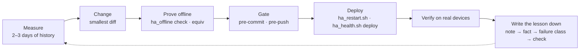

# Engineering methodology

How this platform is built: an AI coding agent with production access does
the engineering, and the method is everything that keeps that safe, cheap
and correct. The method is a working practice, refined over about 2,300
commits, and most of it is enforced by code rather than by intention.

- [In short](#in-short)
- [1. Division of labour](#1-division-of-labour)
- [2. The loop](#2-the-loop)
- [3. One change, start to finish](#3-one-change-start-to-finish)
- [4. Knowledge in three layers](#4-knowledge-in-three-layers)
- [5. Measure, never inherit a number](#5-measure-never-inherit-a-number)
- [6. Failure classes](#6-failure-classes)
- [7. Guardrails as hooks](#7-guardrails-as-hooks)
- [8. The agent's toolkit](#8-the-agents-toolkit)
- [9. Subagents: work yourself, delegate sweeps](#9-subagents-work-yourself-delegate-sweeps)
- [10. Proof without hardware](#10-proof-without-hardware)
- [11. Verification on reality](#11-verification-on-reality)
- [12. Ground truth from the household](#12-ground-truth-from-the-household)
- [13. Cost is an engineering constraint](#13-cost-is-an-engineering-constraint)
- [14. Known limits](#14-known-limits)

## In short

- **The agent engineers; the person decides behaviour.** Claude Code
  diagnoses, writes, deploys and verifies on the production host. The
  household decides how the house should behave, and its answers are the
  ground truth.
- **Every number is measured.** A threshold comes from two to three days of
  recorded history, never from a note or a comment.
- **Mistakes become checks.** A lesson starts as a note, becomes a named
  failure class, and ends as a hook or lint that blocks the mistake.
- **The rules that matter are code.** Hooks inside the agent's own tool calls
  block an unsafe restart, a runaway fleet of subagents, or a commit that
  breaks a copied list.
- **Context is a budget.** The always-loaded instructions are short
  signatures; the details, the domain rules and the step-by-step skills load
  only when a task needs them.

---

## 1. Division of labour

Claude Code runs on the production host (Home Assistant OS on an Intel NUC)
with SSH and REST access. It diagnoses from recorded history, writes the
change, commits, deploys, restarts, verifies and sends a short push
notification that says what went live.

The person does what software cannot: pairing devices, OAuth consents,
pressing a physical button for a test, and deciding how the house *should*
behave. That last split is a written rule. The agent answers technical
questions itself (syntax, entity ids, versions) and asks about behaviour
("should this also fire when nobody is home?"). When the person is not there
to answer, the agent ships the most likely, lowest-risk reading first, then
asks, clearly marked, so work is never blocked on a question nobody sees.

## 2. The loop



The last step is what makes the loop compound. A lesson starts as a short
sprint note (at most three are kept in [CLAUDE.md](../CLAUDE.md), and the oldest
rolls out in the same commit that adds a new one). A lesson that keeps
holding becomes a permanent fact or a failure class, and a failure class that
keeps recurring becomes an automated check.

## 3. One change, start to finish

A fix from October 2026 shows the loop on a real defect.

**The report.** A parent left the house at 04:24 and pressed the living-room
remote's long DOWN, which switches everything off. Two days earlier the same
press had also become the guest button ("someone sleeps in the living room
tonight"), which keeps the open-plan lights and the radio quiet in the
morning. When the other parent got up at 05:57, the welcome light was
refused, and the morning radio started only at 06:13.

**Diagnosis from history.** The agent traced the press, the hold it armed and
the refused welcome in the recorded states. It found two defects: one button
with two meanings, and a radio that listened only for motion that had already
happened, with no trigger on the hold's release (failure class 4, a missing
re-arm).

**The person decides behaviour.** What proves that a guest is there is a
question about intent, so it went to the person: after a DOWN press, the
living room itself must see more than 30 seconds of presence within five
minutes.

**Measured, not guessed.** Thirty days of the living-room radar, zero to five
minutes after the hold was armed: guest nights showed 89 to 300 seconds of
presence, the departure 0. The 30-second line sits in that gap.

**The fix.** A DOWN press that armed the hold itself releases it again
unless the radar sees the presence; both numbers are sliders. The radio now
also starts on the release. The guest's own button, the app and the automatic
arming need no proof, so nothing changes for the cases that already worked.

**The lesson written down.** A three-line note in [CLAUDE.md](../CLAUDE.md):
a button with two meanings must prove the dangerous one.

## 4. Knowledge in three layers

Everything in the agent's always-loaded context is paid for in every
session, including sessions that never touch the subject. The knowledge is
therefore layered by when it is needed:

| Layer | Loaded | Contents |
|---|---|---|
| [CLAUDE.md](../CLAUDE.md) | every session | standing rules, permanent facts and failure classes, each as a one-line signature plus a pointer |
| [`.claude/rules/`](../.claude/rules/) (16 files) | the first time a matching file is touched | domain facts: radar presence, Thread/Matter, bulbs, curtains, energy, voice … |
| `docs/` | only when read | the long version: incidents, measurements, reasoning |
| `docs/auto/` | only when read | generated per-room and per-lamp maps, cheaper than a repository-wide search |

A rule file declares `paths:` globs, and Claude Code loads it natively when a
matching file is read. A hook (`scripts/claude_rules.py hook`) also loads it
when the agent reaches the domain through a shell command, which native
loading does not see. `scripts/claude_rules.py check` fails the commit when a
glob matches no tracked file (a renamed file would silently orphan its rule)
or when CLAUDE.md holds more than three sprint notes, and it warns when
CLAUDE.md grows past its size budget.

**The layers must agree.** A fact has a short form (the signature in CLAUDE.md
or a rule file) and a long form (in `docs/`). When reality changes, both are
corrected in the same commit.

## 5. Measure, never inherit a number

Notes and code comments are hypotheses with a timestamp, not measurements. A
threshold, timing or offset is set from the distribution of the channel the
gate actually reads, over two to three days:

```sh
python3 scripts/hq.py hist sensor.koekken_dagslys_lx --stats   # samples + time-weighted percentiles, local time
```

If the measurement disagrees with the note, the note is stale and is
corrected in the same commit. The `measure-threshold` skill (section 8)
walks the agent through it. Two refinements came from mistakes:

- **Measure the distribution production delivers, not a sample you labelled.**
  A hand-labelled negative set is posed; production delivers the whole
  continuum, so the real gap is narrower than the measured one. *Signature:
  the false positives do not spread out, they cluster just under the
  threshold.*
- **A gate cannot be tuned on its own firings.** They are, by definition, only
  the events that got through.

## 6. Failure classes

[docs/fejlklasser.md](fejlklasser.md) lists 28 recurring defect patterns.
Each has a *signature*, which is how the defect looks in history or behaviour,
and a *method*, which is the check that prevents it. Some examples:

| # | Signature | Method |
|---|---|---|
| 2 | the same rule coded in two places, and they diverge | grep the rule's key expression; consolidate into one anchor |
| 3 | a comment promises "manual always wins", the code does not | a person's action is `context.user_id is not none`, never `parent_id is none` |
| 4 | "it only works if I also do Y" | a flank trigger needs a re-arm path when the flank happened while blocked |
| 14 | "over the limit for 15 minutes" built on `last_changed` | an analog sensor's `last_changed` resets on every report; use a `for:` trigger or `history_stats` |
| 22 | an automation is `unavailable` | Home Assistant disabled it as invalid, silently; check after every deploy |
| 25 | a gate that never fires, while a replay looks healthy | one 1-second radar blip erases "off for N minutes"; measure silence on a sustained anchor |

The list is mined from the project's own history. Measured on 2026-10-04 over
1,984 commits (489 of them fixes), commit messages cite the classes as follows: duplication
(#2) 111 times, missing re-arm (#4) 51, comment ≠ code (#3) 44, asymmetric
protection (#12) 41, the slider ceremony (#5) 40, list drift (#16) 33.
**Duplication, not single mistakes, is the dominant failure.** The top
classes therefore became structure and checks:

| Class | Became |
|---|---|
| #2, #16: the same list copied into many files (25 lists, 152 copies) | [`rosters/`](../rosters/), one file per list, included where it is used; `rosters.py jinja --check` and `roster_drift.py` |
| #5: a new slider needs four manual steps; a fresh install got stale defaults for 283 of 644 sliders | the value snapshot *is* the fresh-install seed; `helpers_export.py --check-derived` |
| #22: invalid automations disabled silently | `ha_offline.py check` before every push; `ha_health.sh deploy` after every deploy |
| template reload fires "off" triggers | `b103_scan.py` blocks a `to:` trigger on a template entity without `from:` |
| Matter timeout aborts a whole script | `ha_validate.py --check matter` requires `continue_on_error` |
| several writers fight over one lamp | the [ownership registry](../ejerskab/) and its generated owner sensor |

## 7. Guardrails as hooks

A rule in text is advice. The rules that protect the house or the budget run
inside the agent's tool calls ([`.claude/settings.json`](../.claude/settings.json)):

| Hook | Event | What it does |
|---|---|---|
| `scripts/session_start.sh` | session start | installs the git hooks (they do not follow a clone), reports how far behind `origin/main` the checkout is |
| `scripts/claude_rules.py hook` | before Read/Edit/Write/Bash/Grep | loads the domain rule the call touches, once per session |
| `scripts/ejerskab_hook.py pre` / `post` | before a file is opened / after it is edited | shows the ownership table of any registered lamp the file writes; lints the edit against the registry |
| `scripts/restart_guard.py` | before Bash | rejects a plain `ha core restart`: Home Assistant crashes during shutdown here and loses the last state write, so restarts go through `scripts/ha_restart.sh`, which saves state first |
| `scripts/agent_guard.py` | before Agent/Workflow, at subagent stop | at most two subagents at a time; a cheaper model on every workflow agent; no unbounded fan-out |

The agent guard is an example of the loop in section 2. The subagent limits
existed as a written rule; one session broke it anyway, and the quota ran out
while the agents were still working. The rule became a hook the same day
(section 9).

The context hooks (rules, ownership) fail open: a broken hook never blocks a
session, because the git hooks are the enforcement. Pre-commit runs the fast
checks, pre-push runs Home Assistant's own config check, and CI runs the same
Makefile targets.
`scripts/tests/test_tooling_parity.py` fails when the three drift apart.

## 8. The agent's toolkit

The agent works through a small set of project-specific instruments. Each
exists because sessions kept doing the same task the slow way or the wrong
way.

### Skills

[`.claude/skills/`](../.claude/skills/) holds playbooks for recurring tasks.
Claude Code shows the agent each skill's name and one-line description; the
full procedure loads only when a task matches it. Rules (section 4) say what
is true in a domain. Skills say how to do a task, step by step, with the
commands that actually exist in this repository.

| Skill | Used when | What it prevents |
|---|---|---|
| [`measure-threshold`](../.claude/skills/measure-threshold/SKILL.md) | setting any threshold, timing or offset | a number inherited from a stale note; a gate tuned on its own firings |
| [`new-slider`](../.claude/skills/new-slider/SKILL.md) | a value should become tunable | a duplicate of a helper that already exists; a slider that skips one of its four steps and starts at its minimum after a fresh install (class 5) |
| [`failure-class-review`](../.claude/skills/failure-class-review/SKILL.md) | before calling an automation change done | the recurring defects of section 6, checked against the diff |
| [`deploy`](../.claude/skills/deploy/SKILL.md) | a commit has to go live | overwriting another session's commits; a template reload that fires switch-off paths; an automation that failed validation silently |
| [`bug-hunt`](../.claude/skills/bug-hunt/SKILL.md) | looking for bugs | a fleet of agents that exhausts the quota before it reports; fixing a "confirmed" finding that is only half the mechanism |

### Command-line tools

| Tool | Answers |
|---|---|
| `scripts/hq.py` | What is this entity called (`find`, folding Danish letters)? What is it now, what was it, and who changed it (`state`, `hist --stats`, `flanks`, `who`)? Where is it used (`where`)? Output is local time and capped at about 40 lines, so a question never floods the context. |
| `scripts/ha_offline.py` | Is the configuration valid and unchanged, judged by Home Assistant itself (section 10)? |
| `scripts/ha_validate.py` | Do the references resolve, are there duplicates, Jinja hazards, Matter calls without `continue_on_error`? |
| `scripts/b103_scan.py` | Does a `to:` trigger on a template entity lack its `from:`? |
| `scripts/rosters.py`, `scripts/roster_drift.py` | Which entity lists are shared, and which copies have drifted apart? |
| `scripts/ejerskab.py` | Who writes this lamp, at which rank (`steder`), and is the generated owner sensor current (`gen`)? |
| `scripts/gen_docs.py` | Regenerates the per-room and per-lamp maps in `docs/auto/`. |
| `scripts/helpers_export.py` | Snapshots every slider value to git; the snapshot seeds a fresh install. |
| `scripts/ha_health.sh` | Did an automation go silent (`deploy`)? Which entities flood the database (`noisy`)? Which radar channels stopped reporting (`blind`)? |
| `scripts/ha_restart.sh` | The only restart path: it saves restore-state first. |
| `scripts/claude_rules.py` | Are the knowledge layers consistent (`check`)? Which domain rule does this call need (`hook`)? |

## 9. Subagents: work yourself, delegate sweeps

Claude Code can start subagents: separate agents with their own context that
work in parallel and report back. They are useful and expensive, and the
policy for them was set by measurement.

**What a subagent costs.** Each one starts cold. It writes 50–65k tokens of
context before it does anything, and the main session verifies its findings
again anyway. Measured on 2026-10-08, the subagents' share of usage had risen
from 4 % to 33 %.

**The policy.**

| Rule | Why |
|---|---|
| Lookups, reading a few files and code changes happen in the main session | the main session already holds the context; a subagent pays to rebuild it |
| Subagents are for broad sweeps (dozens of files, bug hunts) and return only their conclusion | the conclusion is what the main session needs; file dumps inflate its context |
| Code is written by the most capable model | a cheaper main session that has to commit code asks the person to switch models instead of delegating: three delegated agents once cost four times the main session, because each read everything again |
| A cheaper model only for read-only triage, such as bug-hunt finders | triage is verified afterwards; code is not |
| At most two subagents at a time | the quota is shared; a fleet that exhausts it dies without returning a report, and the work has to be run again |

**Enforced, not advised.** On 2026-10-10 a session ran a workflow with the
most capable model as finders and one sceptic per finding, potentially more
than 30 agents. The quota ran out before they could report. The written rule
became `scripts/agent_guard.py` the same day; it checks every Agent and
Workflow call:

- every workflow agent must name a cheaper model;
- no `pipeline()` (it fans out up to the CPU limit), no `while` loops, and
  `parallel()` only over slices of two;
- at most two agents running, and an agent on the most capable model only
  when no other agent is running;
- an opt-in to large multi-agent runs does not lift the limits. Only the
  person can switch the hook off, with a git-ignored file.

**The shape that works.** The bug hunt is the one recurring multi-agent task:
two finders on a cheaper model, one per area, each capped at about 35 tool
calls, read-only, with at most eight findings in a fixed schema; then one
adversarial sceptic per finder. Across three runs it used four agents and
530–590k tokens per run, took 12 to 43 minutes, and no agent died before
reporting. The sceptics are not the last word. In the first run, one
confirmed finding turned out to be half of the mechanism (the real cause was
the colour of a lamp that was off, not the length of the fade), so the main
session checks every confirmed finding in the code and in history before
anything is fixed. The best area to hunt was not the code but a contested
lamp's ownership registry and its recorded writers: the real collisions are
in `hq.py who`.

## 10. Proof without hardware

`scripts/ha_offline.py` installs the exact Home Assistant version in a local
virtual environment and runs its own loader and validator against the
repository, with no devices and no secrets:

| Command | Answers |
|---|---|
| `check` | Is the configuration valid, as Home Assistant itself judges it? |
| `equiv` | Is the resolved configuration identical to the one at another commit? A structural refactor must give an empty diff. |
| `staging` | Does the house boot headless as a fresh install, and what do the sliders start at? |
| `refs` | Does every referenced entity exist? |

Replayed against seven historical incidents, the validator would have caught
five before commit. The two it misses are semantic: a folded Jinja `if` that
renders the string `"false"`, and a service that exists only on the
production host.

## 11. Verification on reality

A change with a physical effect (light, curtains, sound, timing) is not done
when the service call returns. It is done when the recorded state shows the
intended effect: timestamps from history, the colour read back from the bulb,
brightness on the 0–254 scale. Three rules came from false confidence:

- **Synthetic events prove nothing.** A physical button can send an older
  event shape than the one a test fires. Verification uses real device events,
  or evidence in history that the real shape has been seen.
- **Tests leave traces that look like a person.** An API call carries a user
  id, so a test switch-off is recorded as the person's own and starts manual
  overrides. Tests clean up the stamps they may have set.
- **Check that nothing went silent.** `./scripts/ha_health.sh deploy` lists
  automations Home Assistant disabled as invalid during the deploy.

## 12. Ground truth from the household

Several classifiers (the current activity, who arrived, whether a lux reading
is daylight or the room's own lamps, how many people are home) ask the
household when they are unsure. The question is an actionable phone
notification; the answer is appended to a JSONL file with the full signal
context and later serves as labelled data for calibration.

Asking has a cost. Measured over 14 days, the house sent 699 notifications,
and the activity trainer was still asking about a guess that had been right
eight times out of eight. Trainers now ask only while the recent answers for
that kind of guess still disagree with it (`scripts/trainer_tvivl.py`), and
the nightly weather notice is sent again only when its content changes.

## 13. Cost is an engineering constraint

The agent runs on a fixed plan, so tokens are a budget like latency or memory,
and they were measured like one:

- **Context length is the bill.** Every call re-reads the whole conversation;
  cached reads were about 70 % of usage. Conversations are compacted at 200k
  tokens instead of growing toward the 1M window, and unrelated tasks start
  fresh.
- **Subagents start cold.** Each writes 50–65k tokens of context before doing
  anything; when their share of usage rose from 4 % to 33 %, the policy in
  section 9 replaced habit.
- **The always-loaded layer is a recognition layer** (section 4), and its size
  is reported on every commit.

The money goes to diagnosis and verification, which are never cut: digging
through logs for a bug, calibrating against real data, verifying after a
deploy.

## 14. Known limits

- The offline validator checks structure and templates, not intent; two of
  seven replayed incidents were semantic.
- Git hooks do not follow a clone. The session hook reinstalls them in every
  agent session, but a commit made elsewhere without them cannot be detected
  afterwards.
- Skills and rules load by description and path, so an agent can still skip
  a skill that would have applied. The checks that protect the house
  therefore run as hooks and git hooks, not as skills.
- The recorder keeps 30 days of history, so calibration sees recent weeks,
  not seasons.
- Most documentation is Danish, the household's working language.
