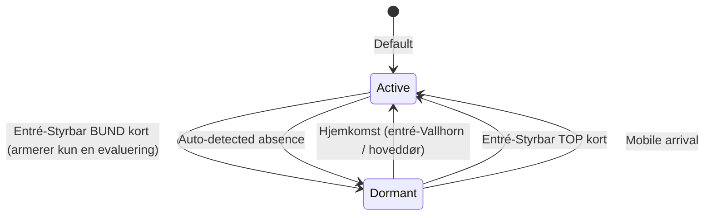
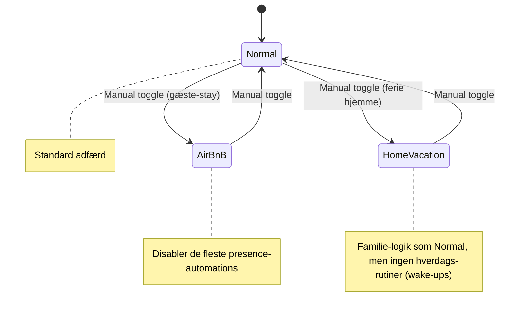
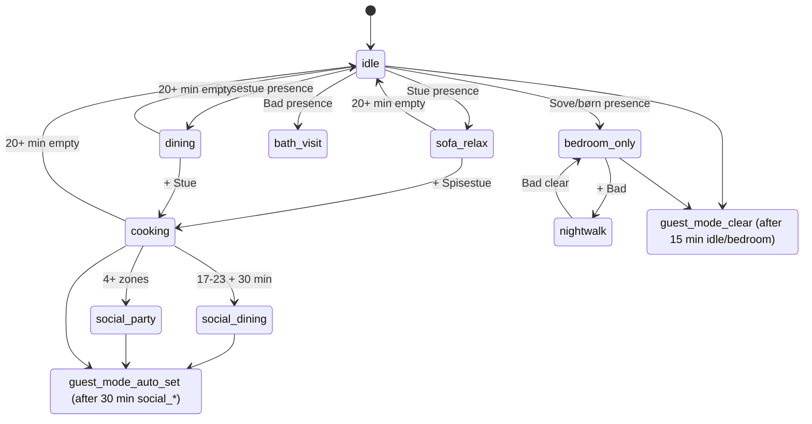
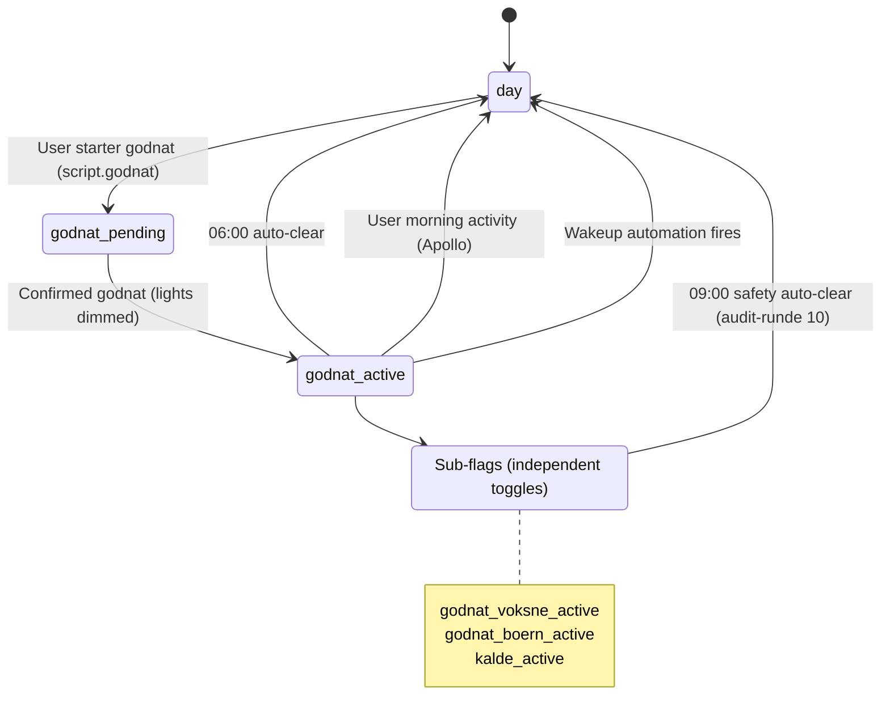
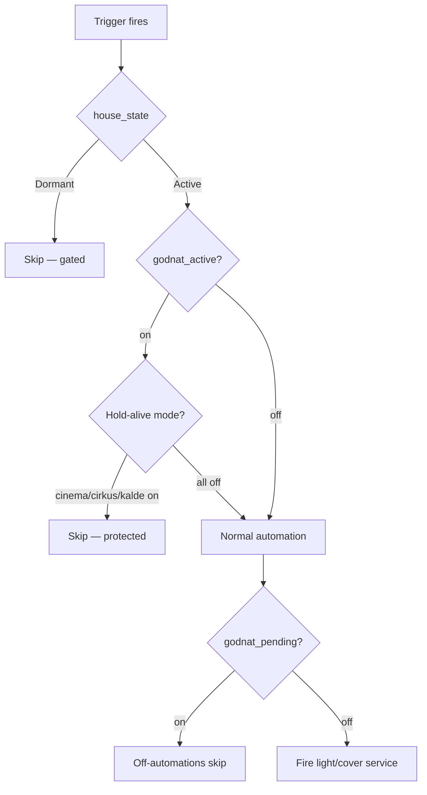
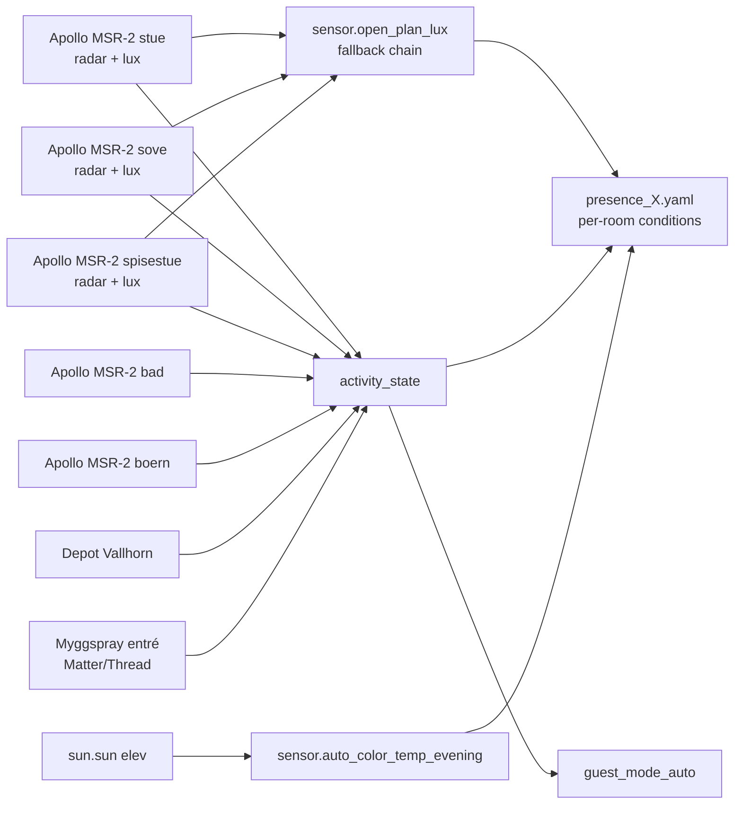
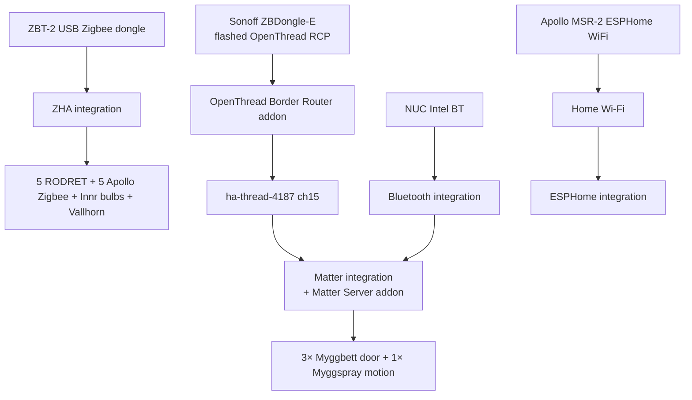

# State Machine Visual

> *Written in Danish. English overview: [README](../README.md) ·
> [ARCHITECTURE](../ARCHITECTURE.md).*

Mermaid diagrams til at forstå hvordan modes interagerer. Render automatically i GitHub.

## Top-level house state

## House mode toggle (orthogonal til state)

## Activity state machine (computed)

## Godnat state machine

## Mode flag interactions (priority order)

## Sensor data flow

## Hardware → Software stack

